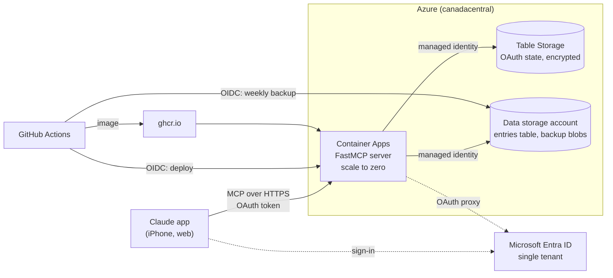

# lifelog-mcp

[](https://github.com/SamuelPoirier-Dev/lifelog-mcp/actions/workflows/ci-cd.yml)

A personal lifelog you talk to. It is a remote [MCP](https://modelcontextprotocol.io)
server, added as a custom connector in the Claude app: everyday entries (habits,
health…) are recorded and queried in plain language, mostly from an iPhone. Other Claude
agents use the same tools, such as a weekly health dashboard and a one-off import of past
entries from Todoist.

The first category is alcoholic drinks, counted in Canadian standard drinks (13.45 g of
alcohol).

```text
Me      2 bières ce soir
Claude  What volume and alcohol content? (355 ml, 5 %?)
Me      473 ml, 5,5 %
Claude  Logged: 2 beers, 473 ml at 5.5 % (3.1 standard drinks).
        This week: 5.2 standard drinks, 4 days without a drink.
```

*(An illustrative exchange: the user writes in French, Claude does the rest.)*

Built as a portfolio project: a small scope, done end to end. Python 3.13, FastMCP,
Azure Container Apps, Azure Table Storage, Microsoft Entra ID, Terraform and GitHub
Actions. Every step and decision is logged in [PLAN.md](PLAN.md) (in French).

## Architecture



- **One process**: a FastMCP server in a Starlette app, served by uvicorn. FastMCP's OAuth
  proxy lets claude.ai sign in with Microsoft Entra ID.
- **Layers**: thin MCP tools ([mcp_server.py](src/lifelog/mcp_server.py)) over a service
  ([service.py](src/lifelog/service.py)), over a `Repository` interface with an in-memory
  and an Azure Table Storage implementation ([storage/](src/lifelog/storage/)).
- **Categories are code**: each one is a module defining its attributes (a Pydantic
  model), its defaults and its statistics ([categories/](src/lifelog/categories/)). Adding
  one means writing a module and registering it; the tools and their schemas pick it up.
  The tests prove it with a fake category.
- **Storage**: one table, one partition per category, and a row key starting with the UTC
  timestamp, so a period is a key range read in time order.

## MCP tools

| Tool | What it does |
|---|---|
| `list_categories` | Categories, what they are for, and the attributes their entries take. |
| `log_entry` | Records 1 to 100 entries in a category, all or nothing. |
| `list_entries` | Entries of a category over a period (current week by default). |
| `get_stats` | Category-specific statistics over a period (current week by default). |

Designing tools for a model, not a programmer, drove most decisions:

- **One call to log.** The description of `log_entry` includes each category's purpose and
  the JSON schema of its attributes. Claude can log "2 bières" without calling
  `list_categories` first.
- **Closed lists.** Categories are an `enum` in the schemas, so Claude cannot invent one.
- **Never guess.** Claude sends only the values the user stated; anything missing is left
  out. The server then answers with an error that says what to ask, such as the volume of
  a beer. Defaults apply only where they are safe (a glass of wine is 142 ml at 12 %). "La même que tantôt" reuses the previous values on purpose.
- **Errors meant for the model.** Validation errors go back word for word, so Claude can
  fix the call or ask the user. Any other error is masked, and its details stay in the
  logs.
- **Time.** Timestamps go in and come out in UTC: the user may be travelling, and a time
  in another zone (or without one) is refused rather than guessed. Days and weeks (periods, stats) stay
  in Québec time, so stats do not depend on where they are read.
- **No edit or delete, on purpose.** Claude confirms with the user when in doubt and does
  not offer corrections it cannot make.
- **Annotations.** Tools say whether they are read-only, destructive or idempotent, so the
  client can decide when to ask for confirmation.

One lesson learned: claude.ai keeps its copy of the tool definitions, even in a new
conversation. A changed description takes effect only after reconnecting the connector.

## Security

- **Sign-in**: single-tenant Entra app that requires user assignment, plus an allow-list
  of Entra object IDs checked by the server. Only the MCP endpoint and the OAuth routes
  exist: no docs, no health route.
- **No keys**: storage accounts accept Entra ID only, reached with managed identities.
  The OAuth state the server keeps is encrypted.
- **Deployments without secrets**: GitHub Actions signs in to Azure with OIDC. The
  deployment identity may only update the Container App. The backup identity may only
  read the entries and write the backups. Actions are pinned by commit SHA and updated by
  Dependabot.
- **Logs without personal data**: tool arguments and entry contents are never logged, and
  the access log is off because URLs carry OAuth codes. Logs are not retained.
- **Data protection**: the data account has a deletion lock, weekly backups, and deleted
  backups can be recovered for 30 days.

## Costs

The real bill since the first deployment is under one cent (CAD). Container Apps scales
to zero and stays within its monthly free grant. The trade-off is a cold start of about
48 s after 30 minutes without requests. Almost all of that delay is Azure allocating a
replica and pulling the image (the app itself loads in about half a second). A monthly budget alert
watches the subscription.

## With more time

- **A read-only REST API** for clients other than Claude. It was planned, then dropped:
  the only reader is a Claude agent, which already has the MCP tools.
- **Edit and delete tools**, with a confirmation step.
- **More categories** (sleep, workouts…), possibly fed by other connectors.
- **A shorter cold start**: warm the app up before the usual times of day, or move to a
  host that keeps a small instance up for free.
- **Alerting** on errors, with logs kept for a few days.
- **A scheduled restore drill** that checks the latest backup.

## Project layout

```text
src/lifelog/
  app.py             ASGI app: auth, storage and MCP server wired together
  mcp_server.py      MCP tools, descriptions and server instructions
  service.py         business operations behind the tools
  categories/        one module per category (drinks.py) and the registry
  storage/           Repository interface, in-memory and Table Storage backends
  auth.py            Entra OAuth proxy and the allow-list middleware
  backup.py          export and restore of the entries table
tests/               pytest, including MCP calls through FastMCP's in-memory client
infra/               Terraform: Container Apps, storage, Entra, CI/CD identities, budget
.github/workflows/   CI/CD and weekly backup
```

## Requirements

- [uv](https://docs.astral.sh/uv/) (installs Python 3.13 automatically if needed)
- Docker (optional, to run the container)
- Node.js (optional, for MCP Inspector)

## Run locally

```bash
uv sync
LIFELOG_AUTH=none LIFELOG_STORAGE=memory uv run uvicorn lifelog.app:create_app --factory --reload
```

`LIFELOG_AUTH=none` turns authentication off and `LIFELOG_STORAGE=memory` keeps entries in
memory (lost on restart), for local use. Without them the server expects the Microsoft
Entra and Table Storage settings below and refuses to start if they are missing.

The MCP endpoint is served at `http://127.0.0.1:8000/mcp` (streamable HTTP transport).

Try it with [MCP Inspector](https://github.com/modelcontextprotocol/inspector):

```bash
npx @modelcontextprotocol/inspector
```

Then choose the *Streamable HTTP* transport, enter `http://127.0.0.1:8000/mcp` and connect.

## Run with Docker

```bash
docker build -t lifelog .
docker run --rm -p 8000:8000 -e LIFELOG_AUTH=none -e LIFELOG_STORAGE=memory lifelog
```

## Tests and lint

```bash
uv run pytest
uv run ruff check .
uv run ruff format --check .
```

Storage tests also run against the real Azure Table Storage on request (they are skipped
by default). They use the Azure CLI login and clean up after themselves:

```bash
LIFELOG_TEST_TABLE_ACCOUNT=$(terraform -chdir=infra output -raw data_storage_account) \
  uv run pytest -m azure
```

## Configuration

Settings are read from environment variables prefixed with `LIFELOG_` (or a `.env` file).

| Variable | Default | Description |
|---|---|---|
| `LIFELOG_LOG_LEVEL` | `INFO` | Python logging level |
| `LIFELOG_AUTH` | `entra` | `entra` (Microsoft Entra ID) or `none` (local development only) |
| `LIFELOG_BASE_URL` | | Public URL of the server (OAuth redirects) |
| `LIFELOG_ENTRA_TENANT_ID` | | Entra tenant ID |
| `LIFELOG_ENTRA_CLIENT_ID` | | Application (client) ID of the Entra app registration |
| `LIFELOG_ENTRA_CLIENT_SECRET` | | Client secret of the Entra app registration |
| `LIFELOG_JWT_SIGNING_KEY` | | Signs the tokens issued to MCP clients; must stay stable |
| `LIFELOG_ALLOWED_OIDS` | | Comma-separated Entra object IDs allowed to use the server |
| `LIFELOG_OAUTH_TABLE_ACCOUNT` | | Storage account holding the OAuth state (in memory if unset) |
| `LIFELOG_OAUTH_TABLE_NAME` | `oauthstate` | Table holding the OAuth state |
| `LIFELOG_OAUTH_STORAGE_ENCRYPTION_KEY` | | Encrypts the OAuth state; required with a table |
| `LIFELOG_STORAGE` | `table` | `table` (Azure Table Storage) or `memory` (local development only) |
| `LIFELOG_TABLE_ACCOUNT` | | Storage account holding the entries table; required with `table` |
| `LIFELOG_TABLE_NAME` | `entries` | Table of entries, one partition per category |

## Deploy to Azure

The infrastructure is described with Terraform in [infra/](infra/): Azure Container Apps
(scale to zero), Azure Table Storage for the entries and their backups, a Microsoft Entra
app registration for sign-in, an Azure Table Storage table for the OAuth state, managed
identities for deployments and backups from GitHub Actions, and a monthly budget alert.
Requirements: an Azure
subscription, the [Azure CLI](https://learn.microsoft.com/cli/azure/) and
[Terraform](https://developer.hashicorp.com/terraform/install).

```bash
az login
```

### 1. Bootstrap (once)

[infra/bootstrap/](infra/bootstrap/) creates the resource group and the storage account
holding the Terraform states, including its own once it exists.

Create `infra/bootstrap/terraform.tfvars`:

```hcl
subscription_id = "<subscription ID>"   # az account show --query id
```

On a new subscription, the storage account does not exist yet: comment out the
`backend` block of [infra/bootstrap/main.tf](infra/bootstrap/main.tf) and apply with a
local state.

```bash
cd infra/bootstrap
terraform init
terraform apply
```

Then put the `tfstate_storage_account_name` output in the `backend` blocks of
[infra/bootstrap/main.tf](infra/bootstrap/main.tf) and
[infra/versions.tf](infra/versions.tf), uncomment the bootstrap's `backend` block and
move its state into the storage account:

```bash
terraform init -migrate-state
```

### 2. First container image

The first `terraform apply` needs an image. Container Apps runs amd64 images; build for
that platform and push to ghcr.io (the package must be public). Later versions are built
and deployed by GitHub Actions (see below).

```bash
docker build --platform linux/amd64 -t ghcr.io/<github user>/lifelog-mcp:<tag> .
docker push ghcr.io/<github user>/lifelog-mcp:<tag>
```

### 3. Infrastructure

Create `infra/terraform.tfvars` (not in git):

| Variable | Description |
|---|---|
| `subscription_id` | Azure subscription ID (`az account show --query id`) |
| `image` | Image of the first creation, e.g. `ghcr.io/<github user>/lifelog-mcp:<tag>` |
| `github_repository` | Optional, repository allowed to deploy, as in its OIDC subject: `owner@owner_id/name@repo_id` (`gh api repos/<owner>/<name>/actions/oidc/customization/sub`) |
| `allowed_oids` | Entra object IDs allowed to use the server (`az ad signed-in-user show --query id`) |
| `budget_email` | Address receiving the budget alerts |
| `budget_amount` | Optional, monthly budget in the billing currency (default `5`) |
| `budget_start_date` | Optional, first day of the first budget month (default `2026-10-01T00:00:00Z`) |

```bash
cd infra
terraform init
terraform apply
```

The `mcp_url` output is the URL to add as a custom connector on claude.ai.

### 4. Continuous deployment

[.github/workflows/ci-cd.yml](.github/workflows/ci-cd.yml) runs lint and tests on every
pull request and push. On `main`, it then builds the image, pushes it to ghcr.io with the
workflow's own token, and deploys it to the Container App. Azure sign-in uses OIDC: a
managed identity trusts the repository's `production` environment and may only update the
Container App. No secret is stored in GitHub. Terraform ignores the image after creation.

Set the `github_variables` output as repository variables (not secrets):

```bash
cd infra
terraform output -json github_variables \
  | jq -r 'to_entries[] | "\(.key) \(.value)"' \
  | while read -r name value; do gh variable set "$name" --body "$value"; done
```

If the ghcr.io package was first pushed by hand, allow the repository to write to it:
package settings, *Manage Actions access*, add the repository with the *Write* role.

Dependabot ([.github/dependabot.yml](.github/dependabot.yml)) proposes monthly updates of
the actions (pinned by SHA), the Docker base images and the Python dependencies.

claude.ai keeps its copy of the tool list, even in a new conversation: after changing tool
descriptions or server instructions, reconnect the connector.

### 5. Backups

[.github/workflows/backup.yml](.github/workflows/backup.yml) exports the entries table
every Sunday (or on demand: *Actions → Backup → Run workflow*) to a dated file,
`entries-YYYY-MM-DD.jsonl`, in the private `backups` container of the data account. Each
line is an entity as stored. The workflow signs in with its own identity, through the
`backup` environment: it may read the table and write the backups, nothing else. Deleted
backups can be recovered for 30 days.

GitHub disables scheduled workflows after 60 days without activity in the repository (it
sends an email first): merging the Dependabot pull requests is enough to keep it running.

To restore, download a backup and write it back. Entries of the file are inserted or
replaced; other entries are left untouched.

```bash
ACCOUNT=$(terraform -chdir=infra output -raw data_storage_account)
az storage blob download --auth-mode login --account-name "$ACCOUNT" \
  --container-name backups --name entries-YYYY-MM-DD.jsonl --file entries.jsonl
uv run python -m lifelog.backup restore --account "$ACCOUNT" --input entries.jsonl
```
